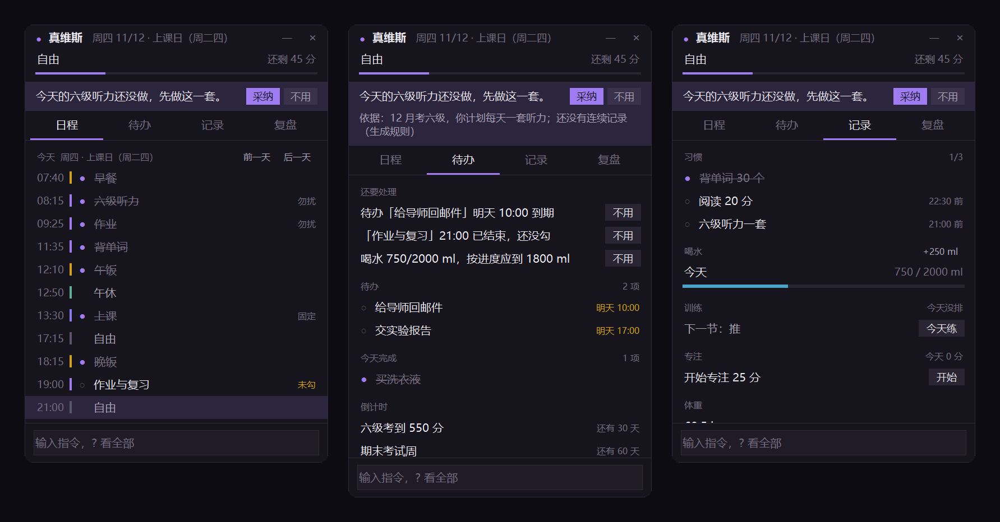
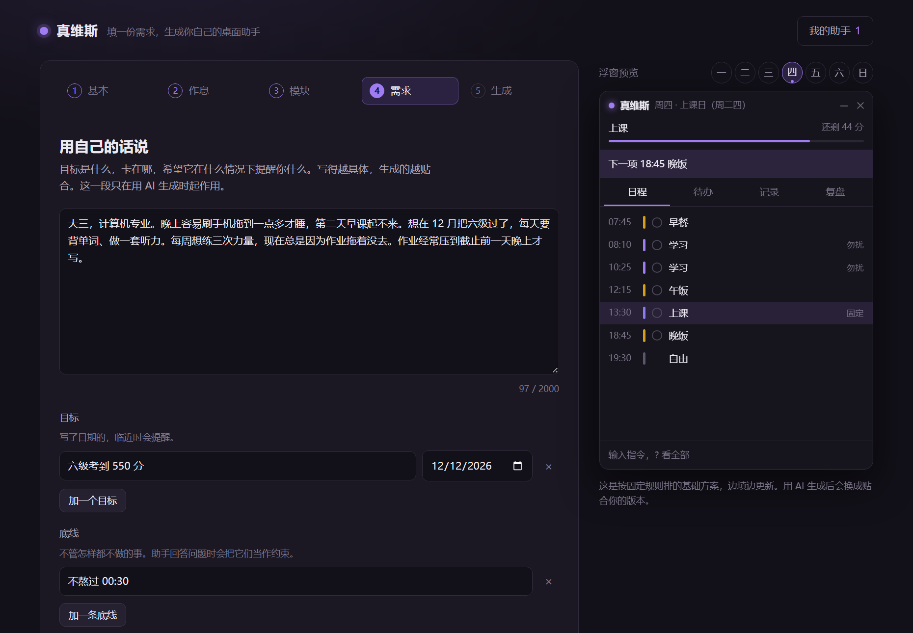
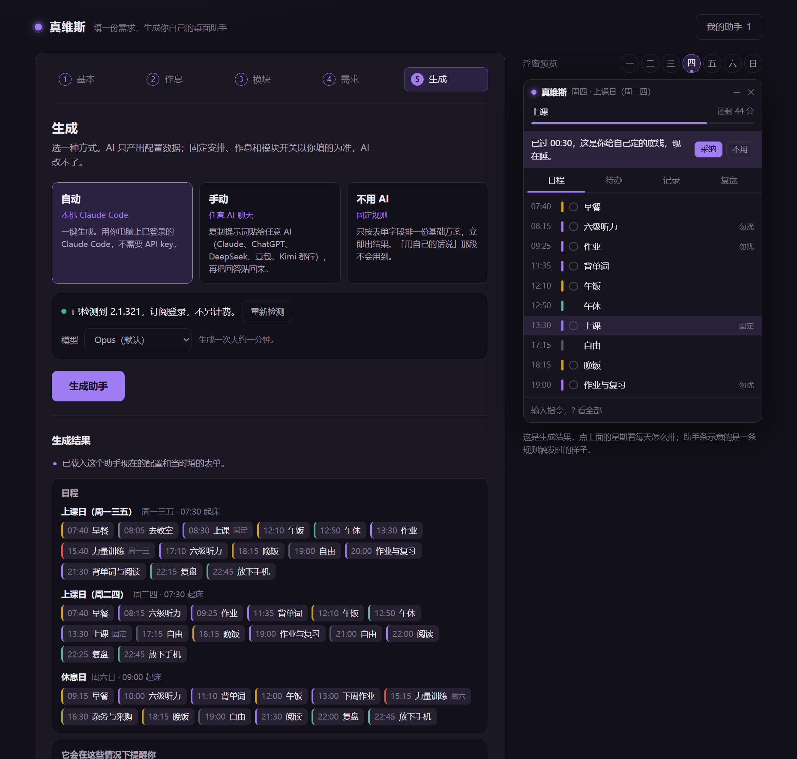

# 真维斯

填一份需求，生成你自己的桌面助手。



在浏览器里填一张表：作息、每周固定的安排、要它管什么，再用自己的话写几句目标和困扰。AI 把这张表变成一份配置，桌面上多出一个置顶的小浮窗。它按你的日程显示现在该做什么，盯着待办、习惯和睡觉时间，一次只提醒一件事，每条提醒都写明依据。

只用 Python 标准库。不用 `pip install`，不用 API key。

## 上手

1. 装 Python 3.9 或更高版本。Windows 安装时勾上 "Add python.exe to PATH"。
2. 下载本仓库：`git clone https://github.com/YujiCui/zhenweisi.git`，或者在页面上点 Code → Download ZIP 后解压。
3. Windows 双击 `start.bat`。macOS 和 Linux 在仓库目录运行 `python3 studio.py`。浏览器会自动打开生成器。
4. 填完五步，点「生成助手」，再点「启动助手」。浮窗出现在屏幕右上角，按住标题栏可以拖走。

不想从空白填起，第一步底部可以载入示例（学生、上班、自由职业三份，都是虚构人物）。



## 三种生成方式

| 方式 | 需要什么 | 费用 | 过程 |
| --- | --- | --- | --- |
| 自动 | 本机装了 [Claude Code](https://claude.com/claude-code) 并已登录 | 订阅登录不另计费；检测到按量计费的登录方式，会先停下来让你确认 | 点一下，约一分钟 |
| 手动 | 任意一个 AI 聊天：Claude、ChatGPT、DeepSeek、豆包、Kimi 都行 | 取决于你用的那个 AI | 复制提示词贴过去，把回答贴回来 |
| 不用 AI | 无 | 无 | 立即出结果，只有基础日程，没有个性化的提醒 |

AI 决定的部分：时间块怎么排、盯哪些习惯、什么情况下提醒什么话、训练和饮食的细节。

AI 改不了的部分：你填的固定安排、起床和睡觉时间、模块开关、助手的名字和配色。合并时这些会按表单重新写一遍；AI 写错的字段被丢弃，并在结果页逐条列出。

AI 的回答只当数据用。生成器不执行其中任何内容，浮窗也只读配置，不运行配置里的东西。



## 浮窗

**当前时间块**。标题栏下面一行是正在进行的时间块和剩余时间。标了「勿扰」的时间块里，只有紧急提醒会出现。

**助手条**。一次只说一件事。点文字展开依据；点「采纳」跳到对应的页，点「不用」今天不再提这一条。同一类提醒你反馈满 6 次、采纳不到两成，它会自动降低优先级，并在依据里写明。

**四个页**

- 日程：今天的时间块，做完点一下勾掉；可以翻到前后几天。
- 待办：带截止时间的待办、倒计时、周期事务、该联系的人。
- 记录：习惯打勾和连续天数、喝水、饮食、训练、专注计时、体重。
- 复盘：近 7 天完成率、近 14 天的几条统计（带样本量，样本不到 6 个会标「样本少」）、当晚的复盘、目标。

没开的模块不显示；一个页里的模块全关了，这个页也不显示。

**指令**。在底部输入框里打字：

| 指令 | 作用 |
| --- | --- |
| `待办 交报告 周五 17:00` | 加一条待办。日期和时间可省，认得「明天」「下周一」「11/20」「今晚 8 点半」 |
| `完成 报告` | 勾掉名称里含这个词的待办 |
| `喝水` / `喝水 500` | 记一杯 / 记 500 ml |
| `吃 鸡胸肉 220 40` | 记一餐：名称、千卡、蛋白克数 |
| `体重 68.5` | 记一次体重 |
| `专注 25` / `停止专注` | 专注计时 |
| `记住 …` / `回忆 关键词` / `忘掉 关键词` | 记忆的写、查、删 |
| `笔记 …` | 记一条当天笔记，在复盘页能看到 |
| `办了 理发` / `联系 张三` | 周期事务、联络各记一次 |
| `问 …` | 向本机 Claude Code 提问，需要开「问答」模块 |
| `撤销` | 撤销上一步操作 |
| `?` | 列出全部指令 |

## 它不做什么

- **浮窗不联网，不调模型。** 唯一的例外是你开了「问答」模块、手动输入 `问 …` 的时候，它调一次本机 Claude Code，一问一答，不带任何工具。这个功能只在订阅登录、且账户没开超额付费时可用。
- **不自动改计划。** 浮窗从不写 `plan.json`。配置只由你或生成器改。
- **不上传数据。** 生成器只监听 `127.0.0.1`，接口要带页面里的令牌，别的网站没法借你的浏览器调它。数据出本机只有两种情况：生成时选了自动或手动方式，表单内容会发给你选的那个 AI；在浮窗里用了 `问 …`，问题和当天的状态会发给 Claude Code。
- 没有语音、手势、可穿戴设备数据和手机同步。

## 数据在哪

每个助手一个文件夹，在仓库目录的 `assistants/` 下（这个目录不进 git）：

| 文件 | 内容 |
| --- | --- |
| `plan.json` | 配置。字段说明见 [docs/plan.md](docs/plan.md) |
| `state.json` | 今天的勾选和记录、待办、反馈统计、窗口位置 |
| `history.json` | 每天一条摘要 |
| `memory.json` | 「记住」写下的内容 |
| `form.json` | 生成时填的表单，供生成器「载入修改」 |

都是纯文本 JSON。删掉文件夹就是卸载；建过桌面快捷方式或开机自启的，再把那个快捷方式删掉。在生成器里删除助手，文件夹会被移到 `assistants/.trash/`，不会直接消失。

`plan.json` 可以手改，保存后浮窗几秒内自动重新载入。改坏了它沿用上一版能用的配置，并在标题栏用红字提示。

## 目录

```
studio.py        生成器入口
assistant.pyw    浮窗入口
zws/             全部逻辑，只用标准库
  schema.py        配置的结构和校验
  rules.py         不用 AI 时的排程规则
  prompt.py        提示词和回答的解析
  generate.py      生成管线与合并
  claude_cli.py    调本机 Claude Code
  brain.py         浮窗的判断：状态、提醒、统计、指令解析
  widget.py        浮窗界面（tkinter）
  server.py        生成器的本机网页服务
web/             生成器的页面
examples/        三份示例表单和一份生成结果
tests/           测试
tools/           重新生成本页截图的脚本
```

## 测试

```
python -m unittest discover -s tests
```

共 111 项。测试不联网，不调真的 Claude Code（用一个假的命令行程序代替）。浮窗的测试会真的开窗口，Windows 上这个窗口几乎全透明、鼠标穿透，不影响你操作。单跑一个文件用 `python tests/test_brain.py`。

## 已知限制

- 只在 Windows 11 上测过，Python 3.12 和 3.13。更早的 Python 版本和 macOS、Linux 都没有实测，无边框置顶窗口在后两个系统上的表现没有验证。
- 自动方式只接了 Claude Code。其他模型走手动方式。
- 界面和提示词只有中文。
- 桌面快捷方式和开机自启只做了 Windows。
- 饮食和训练模块给的是通用模板和你自己填的数字，不是医疗或营养建议。

## 来历

这个项目是从作者自己每天在用的桌面助手里抽出来的。留下了四条原则：一次只说一件事，每条结论带依据，浮窗不联网，不自动改计划。和个人数据绑在一起的部分没有带过来。

## 许可

[MIT](LICENSE)
